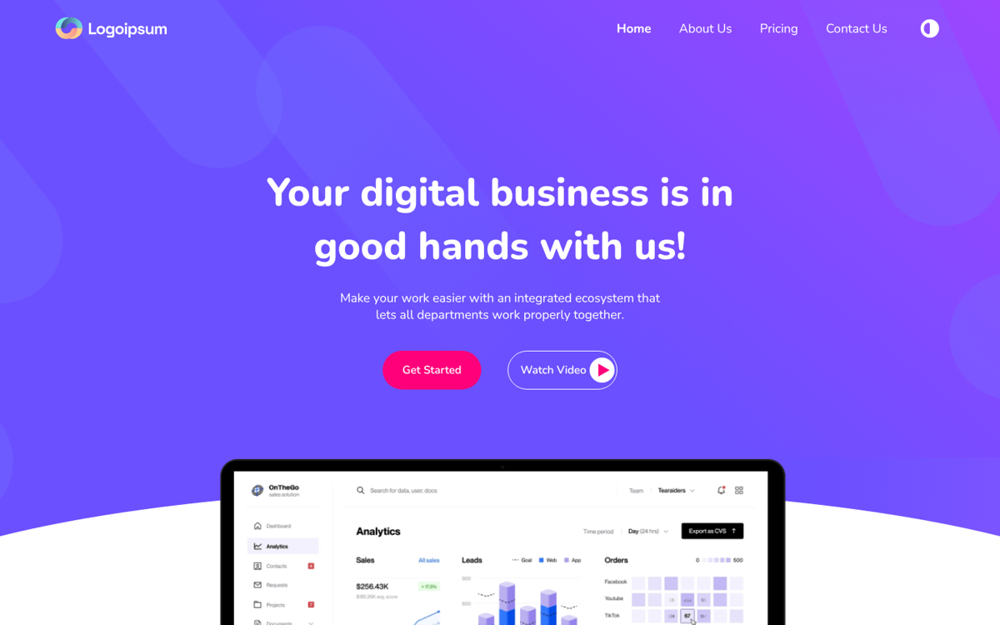

# Logoipsum — Business Landing Page

Final exam project of the 3rd month of a frontend course: SaaS-style landing page with hero, product preview, features and a testimonials slider.

**Live demo:** https://nodirkhuja.github.io/3-oy-imthon/

## Built with
HTML5, SCSS, JavaScript, Slick slider

## About
Learning project from my frontend development course (2022–2023). Layout is built for desktop screens.

Today I focus on AI agents and business automation (n8n, ERP/CRM and API integrations, Telegram bots).
